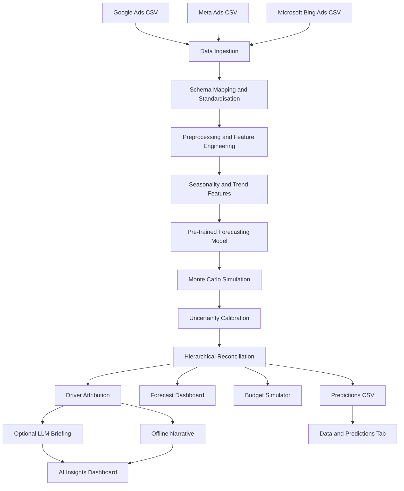
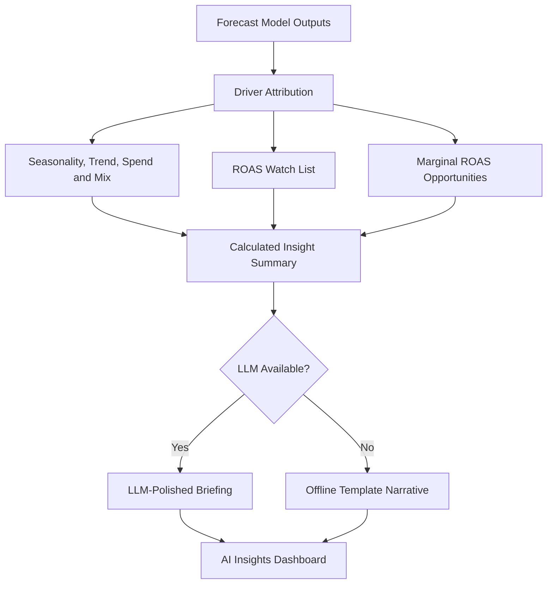

# AIgnition 3.0 — A probabilistic method of forecasting revenue for e-commerce marketing

An AI-assisted forecasting system for digital marketing agencies that combines revenue forecasting, budget simulation, and business insights in a single workflow.

## 1. Project Overview

A forecasting tool for digital marketing agencies that uses AI. It takes in the scattered Google and Meta and Microsoft (Bing) Ads data and generates probabilistic forecasts of e-commerce revenue and blended ROAS across a consistent hierarchy (from aggregate to channel to campaign type to campaign) for 30-day, 60-day and 90-day planning periods.

The system, by taking into account diminishing returns, simulates the effect that different future media budgets will have on revenue and ROAS and produces causal briefings with the help of AI.

The project has two parts: the forecasting pipeline and the interactive dashboard. The forecasting pipeline produces the predictions and the dashboard gives access to the forecasts, the budget simulation, the AI insights and the data.

### Key Features

- **Probabilistic forecasting:** Generates revenue, advertising spend, and ROAS forecasts for 30-, 60-, and 90-day planning periods, along with uncertainty estimates.
- **Hierarchical forecasting:** Organises predictions across aggregate, channel, campaign-type, and campaign levels.
- **Budget simulation:** Evaluates alternative advertising budgets while accounting for diminishing returns.
- **AI-assisted insights:** Converts calculated model outputs into readable business briefings using an optional large language model (LLM).
- **Offline execution:** Runs the core forecasting pipeline without internet access or external API calls.
- **Reproducibility:** Uses a committed pre-trained model and seeded randomness to produce consistent results.

## 2. System Architecture

The project separates data processing, forecasting, and business-facing insights into independent components.

### Architecture Diagram



### Main Components

| Component | Responsibility |
|---|---|
| Data ingestion | Reads advertising CSV files and maps platform-specific columns into a common schema. |
| Taxonomy | Classifies campaigns by advertising channel, campaign type, and brand intent. |
| Preprocessing | Handles date alignment, missing observations, segment panels, and campaign revenue shares. |
| Feature engineering | Builds calendar, seasonality, trend, and other model features. |
| Forecasting model | Applies the committed model to generate future estimates. |
| Uncertainty estimation | Simulates possible future outcomes and calibrates prediction intervals. |
| Hierarchy management | Ensures consistency between aggregate, channel, campaign-type, and campaign forecasts. |
| Budget simulation | Estimates how different spending scenarios may affect revenue and ROAS. |
| Insight engine | Calculates drivers, identifies ROAS concerns, and prepares budget recommendations. |
| Interactive dashboard | Presents forecasts, simulations, data, and insights through a Streamlit interface. |

## 3. Methodology

We model each channel × campaign-type segment with a transparent, glass-box structural decomposition:

`revenue ≈ level · damped-trend · seasonality · spend-response · noise`

The components are estimated using partial pooling so that segments with a limited amount of historical data can borrow a stable seasonal pattern from the population.

Spend generates revenue by means of a constant-elasticity curve (with an empirically observed value of β at approximately 0.6 to 0.8 and less than 1, which shows diminishing returns), and this curve is used in budget simulations.

We determine the level of uncertainty by means of Monte Carlo simulations of daily path movements, using block-bootstrapped, autocorrelated noise as well as shocks to level, trend and macroeconomic variables. The paths are then combined to give totals for 30-, 60- and 90-day periods. Finally, we adjust the widths of the intervals using split conformal methodology so that the actual coverage can be compared with the stated (nominal) level.

The hierarchy appears coherent because the same simulated outcomes are summed over the different segments.

### 3.1 Forecasting Process

The forecasting process consists of the following stages:

1. **Data ingestion:** Reads the available advertising platform data and maps different column names into a standard format.
2. **Preprocessing:** Aligns dates, prepares campaign and segment-level panels, and calculates historical revenue shares.
3. **Feature generation:** Builds seasonal profiles, calendar features, and trend-related inputs.
4. **Model inference:** Loads the committed pre-trained model and applies it to the prepared data.
5. **Simulation:** Generates multiple possible future daily revenue and spending paths.
6. **Uncertainty calibration:** Adjusts the prediction intervals using split-conformal calibration.
7. **Hierarchical aggregation:** Produces consistent forecasts at all reporting levels.
8. **Output generation:** Saves the resulting predictions to a CSV file for further analysis and dashboard use.

### 3.2 Probabilistic Forecasting

Rather than returning only one forecast, the system produces multiple quantiles to describe the distribution of possible outcomes.

The output includes:

- Mean and standard deviation.
- 5th percentile (`p05`).
- Intermediate quantiles.
- 95th percentile (`p95`).

The quantiles provide a way to examine lower and upper forecast scenarios. The interval widths are calibrated using historical forecast errors, although actual coverage may differ from the nominal level under changing market conditions.

### 3.3 Hierarchical Forecasting

The forecasting hierarchy follows this structure:

```text
Aggregate
   |
   +-- Channel
         |
         +-- Campaign Type
               |
               +-- Campaign
```

The hierarchy allows users to move between overall business performance and individual campaign results.

The system uses the same simulated outcomes to construct forecasts across segments, helping ensure that the totals remain consistent between reporting levels. Campaign-level results are allocated using historical revenue shares.

### 3.4 Budget Response Model

The budget simulator uses a constant-elasticity spending-response relationship.

A simplified representation is:

\[
R(S) = A S^\beta
\]

where:

- \(R(S)\) represents expected revenue at spending level \(S\).
- \(A\) represents a scaling factor.
- \(S\) represents advertising spend.
- \(\beta\) represents the spending elasticity.

When \(0 < \beta < 1\), revenue increases with spending, but at a decreasing rate.

This relationship allows the system to compare alternative budget scenarios and estimate their potential effects on revenue and return on advertising spend. These estimates depend on the model's assumptions and historical data.

## 4. AI Integration

The insight layer begins by calculating grounded and deterministic driver attributions, breaking down the amount of the change that can be attributed to seasonality, trend, spending, and campaign mix; it also produces a ROAS watch list and detects marginal-ROAS budget opportunities by using the model's internal mechanisms rather than a language model.

A large language model may then refine these results into an executive summary, being strictly limited to the given figures.

If no API key is available, the system uses a completely offline template narrative so that the product can still produce useful insights.

The LLM is not used in the scored offline pipeline since the pipeline's feature-generation and prediction stages involve no network calls and do not import the LLM layer, no matter whether an API key is configured.

The detection of the provider takes place in the following order: Gemini, then OpenAI, and then Anthropic; and if a necessary key or SDK is missing, or if there is no network access, or if a request times out, or if the response is invalid, the application uses the offline narrative.

### 4.1 AI Insight Workflow



The numerical analysis is performed before the optional language-model step. This keeps the core calculations independent of the LLM and allows the insight layer to continue functioning when external services are unavailable.

### 4.2 Supported LLM Providers

The application automatically detects an available provider in the following order:

1. Gemini.
2. OpenAI.
3. Anthropic.

The selected provider requires a valid API key and its corresponding installed SDK.

The recommended configuration uses Gemini. OpenAI and Anthropic can also be enabled through their respective SDK dependencies.

API keys are stored in a local `.env` file, which is excluded from version control. The example configuration file contains placeholders rather than real credentials.

## 5. Reproducibility and Compliance

- There is a single entry point: the script `run.sh` takes as input the data directory, the model path, and the output path, with reasonable default values.
- **Offline execution:** No network calls are made either during feature generation or when carrying out a prediction. This has been confirmed by blocking the application and the LLM dependencies and then rerunning the pipeline.
- **Deterministic execution:** The randomness is seeded using the random seed that has been configured and with PYTHONHASHSEED set to 0; it has been verified that repeated runs result in outputs that are identical at the byte level.
- **No retraining takes place during evaluation:** The pre-trained model that has been committed to is used, and the closed-form features are calculated directly from the input data.
- **Robustness with regard to schema and size:** Instead of relying on filenames, the advertising platforms are identified using column fingerprints. The pipeline is capable of dealing with different advertisers, various date ranges, and differing numbers of rows.
- **Regarding edge cases:** The pipeline has been tested using an unknown campaign type, a 12-day history, data with zero revenue, and data with zero spending. In all these situations it produces valid output that contains no null values.
- **Null-free output:** Checks are carried out on the generated predictions to make sure that the output includes no missing values.
- **Pinned dependencies:** The dependencies are pinned, and in order to reduce the likelihood of version-mismatch problems when the model is loaded, the model pickle uses a state that contains only NumPy.

The project was developed and tested with Python 3.12.3.

### 5.1 Automated Testing

The project includes an automated test suite covering important parts of the forecasting workflow.

```bash
python tests/test_pipeline.py
```

The test suite includes 13 tests and can also be run using pytest:

```bash
pytest -q
```

The tests cover:

- Data ingestion and schema mapping.
- Meta conversion-to-revenue handling.
- Campaign taxonomy.
- Data preprocessing.
- End-to-end forecasting.
- Output schema validation.
- Quantile ordering.
- Missing-value checks.
- Hierarchical consistency.
- Handling of individual advertising platforms.
- Loading the pre-trained model.

## 6. What the System Produces

The forecasting pipeline generates `output/predictions.csv`.

The file uses a long-format structure, with one row for each combination of forecast horizon, hierarchy node, and metric.

### 6.1 Output Fields

| Field | Description |
|---|---|
| `forecast_origin` | Last observed date used as the forecast origin. |
| `horizon_days` | Forecast horizon: 30, 60, or 90 days. |
| `period_start` | Start of the forecast period. |
| `period_end` | End of the forecast period. |
| `level` | Hierarchy level: aggregate, channel, campaign type, or campaign. |
| `channel` | Advertising channel or blended aggregate. |
| `campaign_type` | Campaign classification. |
| `campaign_id` | Campaign identifier. |
| `campaign_name` | Campaign name. |
| `metric` | Forecast metric: revenue, spend, or ROAS. |
| `currency` | Currency or ratio unit. |
| `mean` | Mean forecast estimate. |
| `std` | Standard deviation of the forecast distribution. |
| `p05`–`p95` | Forecast quantiles describing uncertainty. |

For the bundled sample dataset, the expected output contains 1,404 rows across the four hierarchy levels, with no missing values.

Dormant campaigns with zero forecast spend and zero forecast revenue are assigned a ROAS of zero. A case involving zero spend and positive revenue remains undefined rather than being assigned an arbitrary finite value.

Campaign-level output is capped at the top 500 campaigns per segment based on recent revenue. If this limit is reached, the remaining campaigns are still accounted for at the campaign-type level and above.

The output column specification is centralised in `src/config.py`, allowing the output format to be adjusted without modifying the forecasting engine.

## 7. Interactive Dashboard

The project includes a four-tab dashboard built with Streamlit.

### Dashboard Structure

```text
AIgnition Dashboard
|
+-- Forecast
|     +-- Revenue forecasts
|     +-- Spend forecasts
|     +-- ROAS estimates
|     +-- Forecast horizons
|
+-- Budget Simulator
|     +-- Budget scenarios
|     +-- Revenue response
|     +-- ROAS response
|
+-- AI Insights
|     +-- Driver attribution
|     +-- ROAS watch list
|     +-- Budget opportunities
|     +-- Executive briefing
|
+-- Data & Predictions
      +-- Input data
      +-- Forecast output
      +-- Prediction details
```

### 7.1 Forecast Tab

Displays the generated forecasts across the supported horizons and hierarchy levels, allowing users to examine projected revenue, spend, and ROAS.

### 7.2 Budget Simulator Tab

Allows users to explore alternative media budgets and examine the model's estimated revenue and ROAS response under diminishing returns.

### 7.3 AI Insights Tab

Presents the calculated driver attribution, ROAS watch list, and budget opportunities in a business-oriented briefing. An optional LLM can polish the briefing, while the offline narrative remains available without an API key.

### 7.4 Data & Predictions Tab

Provides access to the available data and forecast output so users can inspect the underlying results.

## 8. Repository Structure

```text
.
├── run.sh
├── run_project.sh
├── requirements.txt
├── requirements-app.txt
├── .env.example
├── .streamlit/
│   └── config.toml
├── data/
│   ├── google_ads_campaign_stats.csv
│   ├── meta_ads_campaign_stats.csv
│   └── bing_campaign_stats.csv
├── pickle/
│   └── model.pkl
├── output/
│   └── predictions.csv
├── src/
│   ├── config.py
│   ├── ingest.py
│   ├── taxonomy.py
│   ├── preprocess.py
│   ├── calendar_features.py
│   ├── seasonality.py
│   ├── decompose.py
│   ├── response.py
│   ├── uncertainty.py
│   ├── simulate.py
│   ├── hierarchy.py
│   ├── model.py
│   ├── backtest.py
│   ├── forecast.py
│   ├── budget.py
│   ├── io_utils.py
│   ├── logging_utils.py
│   ├── insights/
│   ├── generate_features.py
│   ├── predict.py
│   ├── train.py
│   └── briefing.py
├── app/
│   └── streamlit_app.py
├── docs/
└── tests/
    └── test_pipeline.py
```

### Important Files

- `run.sh`: Main entry point for the scored forecasting pipeline.
- `run_project.sh`: Optional wrapper for running the pipeline or dashboard.
- `src/ingest.py`: Reads and standardises advertising platform data.
- `src/forecast.py`: Coordinates the forecasting process.
- `src/uncertainty.py`: Handles uncertainty estimation and interval calibration.
- `src/hierarchy.py`: Maintains consistency across forecast levels.
- `src/budget.py`: Implements budget scenario simulations.
- `src/insights/`: Contains the insight-generation and optional LLM components.
- `src/train.py`: Rebuilds the model during development when required.
- `app/streamlit_app.py`: Runs the interactive dashboard.
- `tests/test_pipeline.py`: Contains the pipeline validation tests.
- `pickle/model.pkl`: Stores the committed pre-trained model.

## 9. How to Run the Project

### 9.1 Requirements

- Python 3.12.
- A compatible Python environment.
- The dependencies listed in the relevant requirements file.
- The supplied advertising data and pre-trained model.

### 9.2 Run the Forecasting Pipeline

Create and activate a virtual environment, then install the core dependencies.

```bash
python3 -m venv .venv
source .venv/bin/activate

pip install -r requirements.txt
```

Run the forecasting pipeline:

```bash
./run.sh ./data ./pickle/model.pkl ./output/predictions.csv
```

The default paths are already configured, so the pipeline can also be started with:

```bash
./run.sh
```

Once execution is complete, the predictions are available at:

```text
output/predictions.csv
```

The scored pipeline loads the committed model rather than retraining it. Model retraining is an optional development step:

```bash
python src/train.py --data-dir ./data --out ./pickle/model.pkl
```

### 9.3 Run the Interactive Dashboard

Install the application dependencies:

```bash
pip install -r requirements-app.txt
```

Start the Streamlit application:

```bash
streamlit run app/streamlit_app.py
```

The dashboard can operate without an API key. To enable LLM-polished briefings, copy the example environment file:

```bash
cp .env.example .env
```

Add a valid provider key to `.env`, for example:

```text
GEMINI_API_KEY=your-key-here
```

The application detects the configured provider and uses the offline narrative if the LLM is unavailable.

**Security note:** Never commit a real API key or the `.env` file to the repository.

### 9.4 Run the Briefing from the Command Line

The insight briefing can also be generated without opening Streamlit:

```bash
python src/briefing.py
```

To force the offline narrative:

```bash
python src/briefing.py --no-llm
```

## 10. Overall Objective

The aim is to develop a forecasting system for digital marketing agencies which incorporates probabilistic revenue forecasts, hierarchical reporting, budget simulation, and AI-supported business insights. This system is intended to aid with planning over 30-, 60-, and 90-day periods while at the same time ensuring reproducibility and fulfilling the offline execution needs of the AIgnition 3.0 submission.

## 11. Team

- **Team:** `natbarpradhannatbar008`
- **Member:** Natabar Pradhan
- **College:** Indian Institute of Technology, Kharagpur

## 12. Submission Command

The main command for running the scored pipeline is:

```bash
./run.sh ./data ./pickle/model.pkl ./output/predictions.csv
```

The forecasting pipeline is designed to run offline using the committed pre-trained model, while the interactive dashboard provides an additional interface for exploring forecasts, budget scenarios, and AI-assisted insights.
